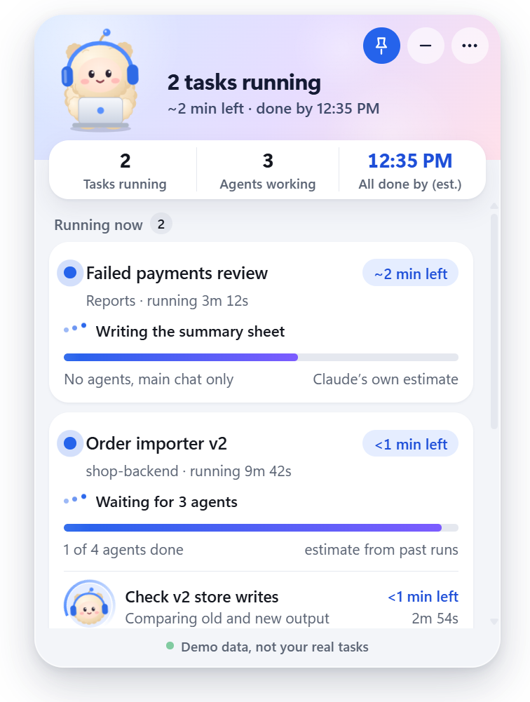

# Claude Tasks sticky

A small always-on-top desktop note for Windows that shows what your Claude Code sessions are doing, so you do not have to open VS Code to check.



## What it shows

- Every open Claude Code session: running, waiting for you, just finished, or idle.
- For a running session: the current step, time so far, estimated time left, and each agent with its own status.
- A Windows notification when a session finishes or needs your input.
- Click a session to open that exact chat in VS Code.
- A mascot, Puff, who types while tasks run, waves when Claude needs you and celebrates when one finishes.

## Run it

Needs Windows 10 or 11, Node.js 20 or newer, and the Claude Code extension for VS Code.

```
npm install
npm start
```

- `npm run demo` starts it on sample data, so every state can be seen without real tasks.
- Opening `renderer/index.html` in a browser plays the same demo without Electron.
- If Electron's program file is missing after `npm install`, run `node node_modules/electron/install.js` once.
- When starting it from a terminal inside VS Code, clear `ELECTRON_RUN_AS_NODE` first. That variable is set there and makes Electron run as plain Node.

On first start it adds a "Claude Tasks" shortcut to the Desktop and the Start Menu, and a tray icon.

## Using it

| Do this | Result |
| --- | --- |
| Drag the coloured header | Move the note |
| Drag a bottom corner sideways | Scale the whole note, 60% to 150% |
| Drag a bottom corner up or down | Set its height |
| Double-click a bottom corner | Back to the default size |
| The minus button | Collapse to a small bar |
| The three-dot button, or the tray icon | Theme, size, notifications, demo mode, start with Windows, quit |

## How it works

`collector.js` only reads Claude Code's own files under `~/.claude`. It never writes there.

| File | Used for |
| --- | --- |
| `sessions/<pid>.json` | One per open session: name, folder, status (`busy`, `idle`, `waiting`) |
| `projects/<project>/<sessionId>.jsonl` | The transcript: current step, when the turn started |
| `projects/<project>/<sessionId>/subagents/agent-*.jsonl` and `.meta.json` | One per agent: what it is doing, whether it has finished |

Time left is an estimate. If Claude wrote one in the chat ("about 5 minutes"), that is used. Otherwise it is the median length of past runs that lasted longer than the current one has so far. When a task outlasts everything in that history, the note says "running long" instead of guessing.

`node collector.js` prints what the note would show right now.

| Path | Role |
| --- | --- |
| `main.js` | Electron window, tray, notifications, sizing |
| `preload.js` | The few calls the page is allowed to make |
| `collector.js` | Reads `~/.claude` and builds the list of tasks and agents |
| `renderer/` | The note itself: `app.js`, `styles.css`, the mascot in `mascot.js`, sample data in `demo.js` |

## Limits

- The files under `~/.claude` are not a public format. This was built against Claude Code 2.1.3xx and may need changes when that format moves.
- Windows only for now: the VS Code path, shortcuts and notifications are Windows-specific.
- It is not an Anthropic product.
