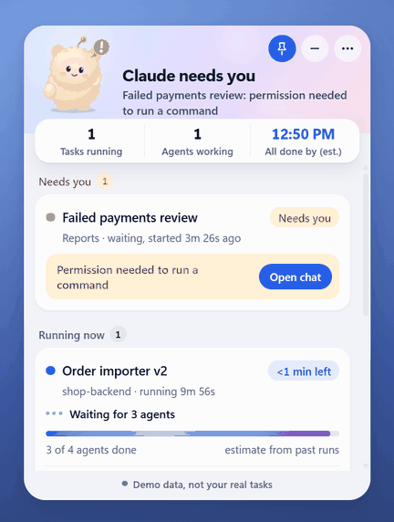
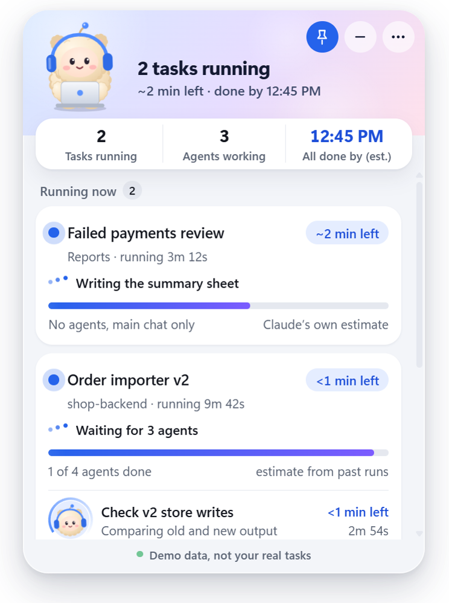
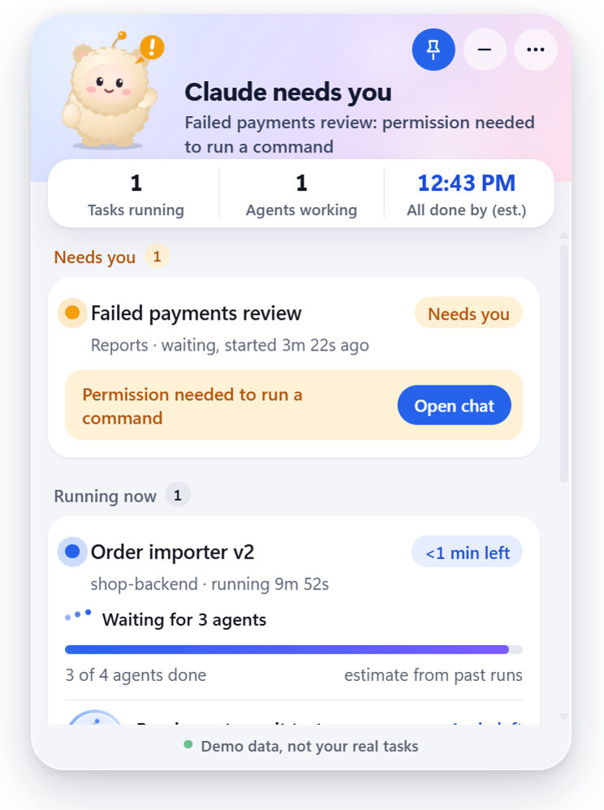
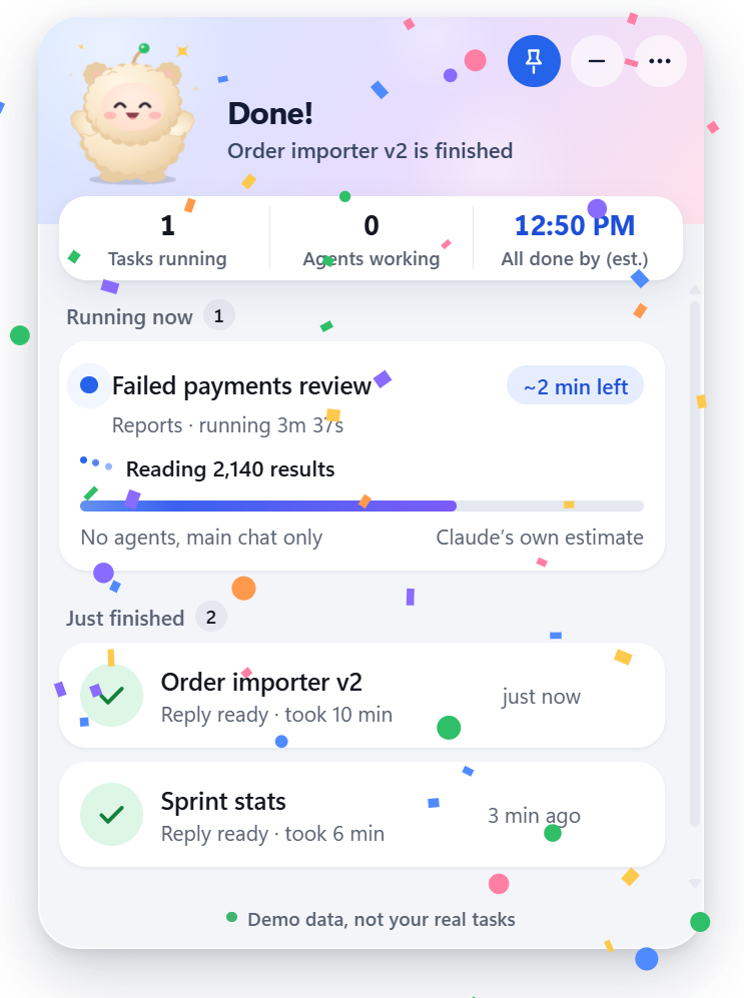
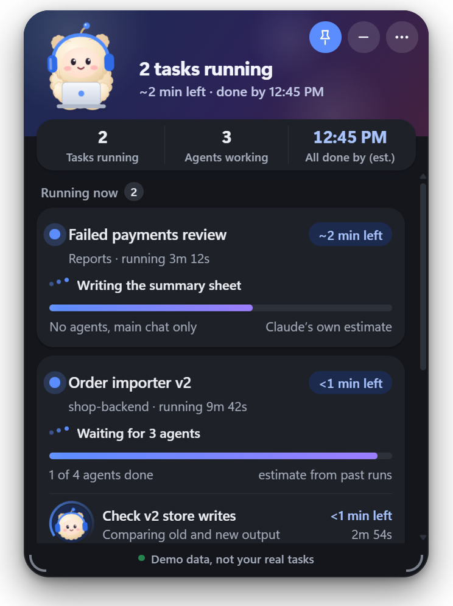
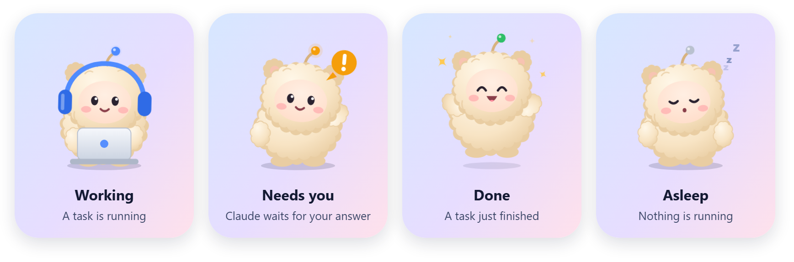

# AgentsAssist

**See what your Claude Code agents are doing without opening VS Code.**

AgentsAssist is a small sticky note that stays on your Windows desktop. It lists every Claude Code session you have open, shows which ones are working, what each agent is doing right now, and roughly how long is left. When a task finishes or Claude needs an answer from you, the note tells you.

<p align="center">
  
</p>

## Why

A long Claude Code task can run for many minutes and start several agents. Until now the only way to know whether it was still working, stuck on a permission question, or already done was to switch back to VS Code and look. With a dozen chats open, that is a lot of looking.

AgentsAssist puts that answer in a corner of the screen.

## What it shows

- **Every open session**, grouped as Needs you, Running now, Just finished and Idle.
- **For a running task**: the step it is on right now, how long it has run, an estimate of the time left and a progress bar.
- **Each agent** of that task: its name, what it is doing, and its own time left. An agent turns green with a tick when it finishes.
- **Needs you**: the card turns orange when Claude is waiting for a permission or an answer, with a button that takes you to that chat.
- **Just finished**: a finished task stays on the note for 15 minutes with how long it took.
- **Windows notifications** when a task finishes or needs you.
- **One click opens that exact chat** in VS Code, in the right window.

## How it looks

<table>
  <tr>
    <td align="center"><b>Running</b></td>
    <td align="center"><b>Needs you</b></td>
  </tr>
  <tr>
    <td></td>
    <td></td>
  </tr>
  <tr>
    <td align="center"><b>Finished</b></td>
    <td align="center"><b>Dark theme</b></td>
  </tr>
  <tr>
    <td></td>
    <td></td>
  </tr>
</table>

Short on space? Collapse it to a small bar. It still shows the count, the agents and the time left.

<p align="center">
  
</p>

## Meet Puff

Puff is the note's mascot, and also its status light. You can tell what is going on from across the room.

<p align="center">
  
</p>

Puff is an original character drawn in SVG and animated with CSS. The same face is the app and tray icon, with a coloured dot for busy, needs you and done.

## Install and run

You need Windows 10 or 11, [Node.js](https://nodejs.org) 20 or newer, and the Claude Code extension for VS Code.

```
git clone https://github.com/SiddheshPatil01/AgentsAssist.git
cd AgentsAssist
npm install
npm start
```

The first start adds a "Claude Tasks" shortcut to the Desktop and the Start Menu, and an icon to the tray.

Good to know:

- `npm run demo` starts it on sample data, so you can see every state without a real task running.
- Opening `renderer/index.html` in a browser plays the same demo without Electron.
- If Electron's program file is missing after `npm install`, run `node node_modules/electron/install.js` once.
- When you start it from a terminal inside VS Code, clear the `ELECTRON_RUN_AS_NODE` variable first. VS Code sets it, and it makes Electron run as plain Node.

## Using it

| Do this | Result |
| --- | --- |
| Click a task | Opens that chat in VS Code |
| Drag the coloured header | Moves the note; it remembers the spot |
| Drag a bottom corner sideways | Scales the whole note, from 60% to 150% |
| Drag a bottom corner up or down | Sets the note's height |
| Double-click a bottom corner | Back to the default size |
| The minus button | Collapses the note to a small bar |
| The pin button | Always on top, on or off |
| The three-dot button, or the tray icon | Theme, size, notifications, demo mode, start with Windows, quit |

## How it works

AgentsAssist only reads the files Claude Code already keeps under `~/.claude`. It never writes there, and it sends nothing anywhere.

| File | Used for |
| --- | --- |
| `sessions/<pid>.json` | One per open session: its name, folder and status (`busy`, `idle` or `waiting`) |
| `projects/<project>/<sessionId>.jsonl` | The transcript: the current step and when the turn started |
| `projects/<project>/<sessionId>/subagents/agent-*.jsonl` and `.meta.json` | One per agent: what it is doing and whether it has finished |

**Time left is an estimate.** If Claude wrote one in the chat ("about 5 minutes"), the note uses that. Otherwise it takes the past runs that lasted longer than the current one has so far, and uses their median. When a task outlasts everything in that history, the note says "running long" instead of guessing.

**Opening a chat** uses the Claude Code extension's own link, `vscode://anthropic.claude-code/open?session=<id>`, after bringing the VS Code window of that folder to the front.

`node collector.js` prints what the note would show right now, which helps when something looks wrong.

## Project layout

| Path | Role |
| --- | --- |
| `main.js` | The Electron side: window, tray, notifications, sizing, opening chats |
| `preload.js` | The short list of calls the page is allowed to make |
| `collector.js` | Reads `~/.claude` and builds the list of tasks and agents |
| `renderer/app.js`, `renderer/styles.css` | The note itself and its animations |
| `renderer/mascot.js` | Puff |
| `renderer/demo.js` | Sample data on a 56 second loop |

The images on this page come from the app itself: `electron . --demo --shot=<file.png>` saves a picture of the note. The options are listed above `runShot` in `main.js`.

## Limits

- The files under `~/.claude` are not a public format. This was built against Claude Code 2.1.3xx and may need changes when that format moves.
- Windows only for now. The VS Code path, the shortcuts and the notifications are Windows-specific.
- The time left is only as good as your history. On a new machine it starts with a rough default.
- This is a personal project and is not an Anthropic product.

Built with Claude Code.
